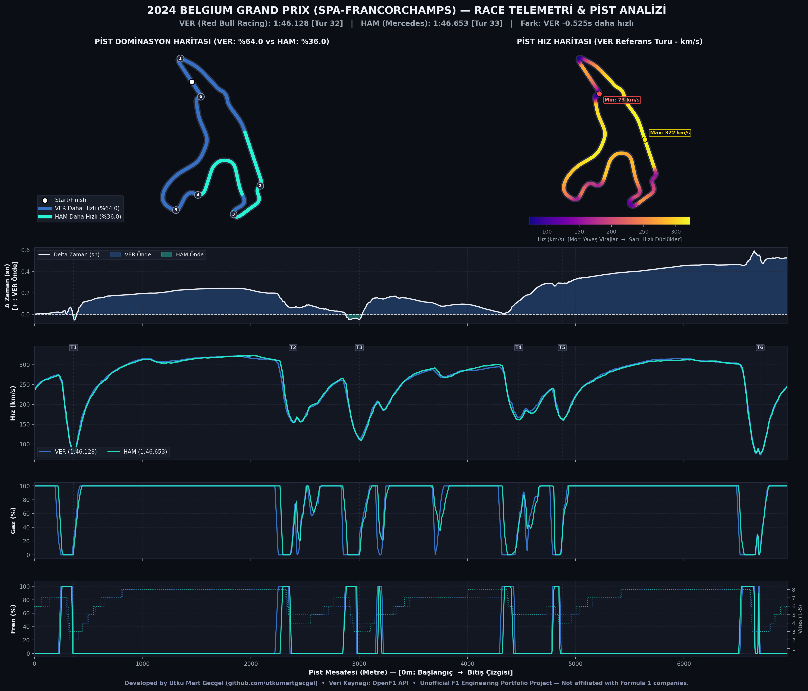

# 🏎️ F1 Pitwall: Telemetry, Driving Style & Track Dominance Analyzer


-E10600)


**[🇬🇧 English Documentation](#-english-documentation) | [🇹🇷 Türkçe Dokümantasyon](#-türkçe-dokümantasyon)**

> 👨‍💻 **Author / Geliştirici:** [Utku Mert Geçgel](https://github.com/utkumertgecgel)



---

# 🇬🇧 English Documentation

## 🎯 Overview & Engineering Problem Solved

An open-source Formula 1 race engineering and telemetry analytics platform built with **OpenF1 API**, **Pandas**, **NumPy**, **SciPy**, **Matplotlib**, and **Streamlit**. It compares the fastest qualifying or race laps of two F1 drivers by aligning high-frequency car sensor streams along a unified **Track Distance (Meters)** axis.

Standard timing sheets only reveal total lap and sector gaps (e.g., `+0.082s`), making it impossible to see **where** and **why** time was gained or lost. Furthermore, comparing two laps over *elapsed time* is mathematically flawed because cars traveling at different speeds are at different physical locations on the circuit at any given timestamp.

This project solves that problem using real-world motorsport engineering techniques:

1. **Distance-Based Linear Interpolation (`np.interp`):**
   * Aligns both cars' sensor channels (`Speed`, `Throttle`, `Brake`, `nGear`, `RPM`, `X`, `Y`) onto a uniform **1,500-point distance grid** from the start line (`0m`) to the checkered flag.
   * Computes cumulative **Delta Time ($\Delta t$)** at every meter via $\Delta t(d) = t_2(d) - t_1(d)$, calibrated to the official finish-line gap.
2. **Track Dominance Map (25 Micro-Sectors):**
   * Applies a 2D rotation matrix to GPS track coordinates (`X, Y`) and segments the circuit into **25 micro-sectors**.
   * Colors each segment with the faster driver's team hex code *(automatically assigning high-contrast `#FFD700` gold when comparing teammates)*.
3. **Track Speed Heatmap:**
   * Visualizes straight-line top speeds and heavy braking zones across the circuit layout using a `plasma` color gradient, automatically annotating global **Max** and **Min** speed points.
4. **Automated Corner Apex Detection via Signal Processing (`scipy.signal.find_peaks`):**
   * Identifies every corner apex (`T1, T2, ...`) directly from local minima in the speed profile and generates a corner-by-corner **Minimum Apex Speed** comparison table ($\pm 35\text{ m}$ window).

---

## 🏗️ Project Architecture

```text
f1-telemetry-analyzer/
├── app.py                      # Interactive Streamlit Web Dashboard (Pitwall UI)
├── generate_poster.py          # Command-Line Interface (CLI) for high-res PNG poster generation
├── src/
│   ├── __init__.py
│   ├── data_loader.py          # OpenF1 API client, local JSON caching & fastest lap extraction
│   ├── telemetry_analyzer.py   # Distance interpolation, Δt math, track dominance & apex detection
│   └── plotter.py              # Dark-themed 6-panel Matplotlib Pitwall visualization engine
├── tests/
│   └── test_telemetry.py       # Automated mathematical & unit test suite (Pytest)
├── assets/                     # Sample output posters
├── requirements.txt            # Python dependencies
├── LICENSE                     # MIT License
└── README.md                   # Bilingual documentation (EN / TR)
```

---

## 🚀 Quick Start & Usage

### 1. Clone the Repository & Install Dependencies
```bash
git clone https://github.com/utkumertgecgel/f1-telemetry-analyzer.git
cd f1-telemetry-analyzer
pip install -r requirements.txt
```

### 2. Launch the Interactive Web Dashboard (Recommended)
```bash
streamlit run app.py
```
Select **Season Year (`2023–2026`)**, **Grand Prix**, **Session (`Qualifying / Race`)**, and **2 Drivers** from the sidebar to generate live telemetry analysis and export high-resolution `.png` posters with one click.

### 3. Generate Posters Directly via CLI
```bash
python generate_poster.py --year 2024 --gp "Belgium" --session R --d1 VER --d2 HAM --out assets/sample_telemetry_poster.png
```

### 4. Run the Automated Unit Test Suite (`pytest`)
```bash
pytest -v
```

---

## 🛣️ Roadmap & Future Configurable Features

This project is actively designed with a modular architecture to support upcoming configurable features:
* [ ] **3-Driver Multi-Comparison Mode:** Simultaneous telemetry overlay and 3-way track dominance mapping (e.g., comparing the top 3 qualifiers in Q3).
* [ ] **Tyre Strategy & Degradation Analytics:** Stint-by-stint lap time evolution, fuel-corrected tyre degradation curves (`SOFT`, `MEDIUM`, `HARD`), and pit-stop undercut/overcut window analysis.
* [ ] **Configurable Micro-Sector & Corner Zoom:** Interactive distance range sliders allowing users to zoom into a specific corner complex (e.g., *Eau Rouge – Raidillon* or *Maggotts – Becketts*) with customizable braking/throttle thresholds.
* [ ] **Live Telemetry Replay Cursor:** Synchronized hover cursor across all telemetry channels and the 2D circuit map.

---
---

# 🇹🇷 Türkçe Dokümantasyon

## 🎯 Projenin Amacı ve Çözdüğü Mühendislik Problemi

**OpenF1 API**, **Pandas**, **NumPy**, **SciPy**, **Matplotlib** ve **Streamlit** kullanılarak geliştirilmiş; iki Formula 1 pilotunun sıralama (*Qualifying*) veya yarış (*Race*) turlarını **Mesafe (Metre)** ekseninde hizalayarak karşılaştıran açık kaynaklı bir yarış mühendisliği ve telemetri analiz platformudur.

Bir Formula 1 turunda iki pilot arasındaki **0.050 saniyelik** farkın pistin tam olarak hangi metresinde ve neden oluştuğunu standart sonuç tablolarıyla görmek imkansızdır. Ayrıca iki aracı **zamana göre** karşılaştırmak, hız farkından dolayı turun aynı saniyesinde araçlar pistin farklı noktalarında olacağı için hatalı sonuç verir.

Bu proje, gerçek F1 yarış mühendislerinin *Pitwall* ekranlarında kullandığı matematiksel yaklaşımla çalışır:

1. **Mesafe Bazlı Lineer İnterpolasyon (`np.interp`):**
   * Her iki aracın sensör verileri, başlangıç çizgisinden (`0m`) bitiş çizgisine kadar **1500 eşit mesafe noktasında** ($\text{Distance}$) hizalanır.
   * Kümülatif zaman farkı ($\Delta t$), her metrede $\Delta t(d) = t_2(d) - t_1(d)$ formülüyle hesaplanır ve bitiş çizgisinde resmi tur farkına kalibre edilir.
2. **Pist Dominasyon Haritası (Track Dominance Map):**
   * Aracın GPS koordinatları (`X, Y`) rotasyon matrisiyle döndürülür ve pist **25 mikro-sektöre** bölünür.
   * Her sektörde ortalama hızı daha yüksek olan pilotun takım rengi harita üzerine işlenir *(takım arkadaşı karşılaştırmalarında otomatik kontrast renk atanır)*.
3. **Pist Hız Isı Haritası (Track Speed Heatmap):**
   * Pist üzerindeki en yüksek düzlük hızı (*Top Speed*) ve en sert frenleme / minimum viraj hızı bölgeleri `plasma` renk geçişiyle görselleştirilir.
4. **Sinyal İşleme ile Otomatik Viraj Apeks Tespiti (`scipy.signal.find_peaks`):**
   * Hız profilindeki lokal minimum noktaları analiz edilerek pistteki tüm viraj merkezleri (`T1, T2, ...`) otomatik tespit edilir ve her virajın $\pm 35\text{ m}$ penceresindeki minimum geçiş hızları (*Apex Speed*) raporlanır.

---

## 🛣️ Yol Haritası ve Gelecek Konfigüre Edilebilir Özellikler (Roadmap)

Proje, ilerleyen sürümlerde aşağıdaki özelleştirilebilir modülleri destekleyecek şekilde modüler olarak tasarlanmıştır:
* [ ] **3 Pilotlu Çoklu Karşılaştırma Modu:** Aynı anda 3 farklı pilotun (örneğin Q3'teki ilk 3 pilotun) telemetri eğrilerini ve 3 renkli pist dominasyon haritasını karşılaştırma.
* [ ] **Lastik Stratejisi ve Degradasyon (Aşınma) Analizi:** Yarış boyunca lastik hamurlarının (`SOFT`, `MEDIUM`, `HARD`) tur sürelerine etkisi, yakıt yükü düzeltmeli (*Fuel-Corrected*) aşınma eğrileri ve pit-stop strateji analizleri.
* [ ] **Konfigüre Edilebilir Sektör & Viraj Yakınlaştırma (Zoom):** Kullanıcının belirli bir viraj grubuna (ör. *Eau Rouge* veya *1. Sektör*) özel mesafe aralığı seçerek detaylı frenleme/çekiş analizi yapabilmesi.
* [ ] **Senkronize Telemetri İmleci:** Grafik üzerinde gezinen imlecin harita üzerinde araçların o metredeki konumunu canlı göstermesi.

---

## 👨‍💻 Geliştirici & Lisans

* **Geliştirici:** Utku Mert Geçgel — [@utkumertgecgel](https://github.com/utkumertgecgel)
* **Lisans:** Bu proje [MIT Lisansı](LICENSE) altında lisanslanmıştır.

### ⚖️ Yasal Uyarı / Disclaimer
Bu proje tamamen eğitim, veri bilimi portföyü ve mühendislik analizi amacıyla açık kaynaklı `OpenF1 API` verileri kullanılarak geliştirilmiştir. Resmi Formula 1 logosu veya telifli medya içermez.
> *This project is unofficial and is not associated in any way with the Formula 1 companies. F1, FORMULA ONE, FORMULA 1, FIA FORMULA ONE WORLD CHAMPIONSHIP, GRAND PRIX and related marks are trade marks of Formula One Licensing B.V.*
